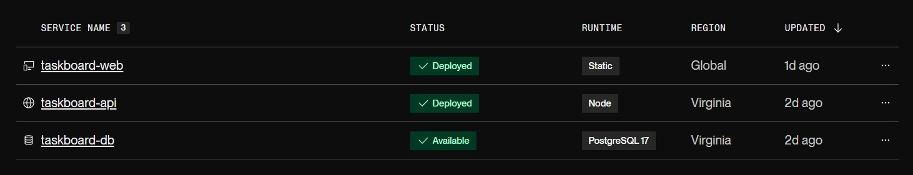
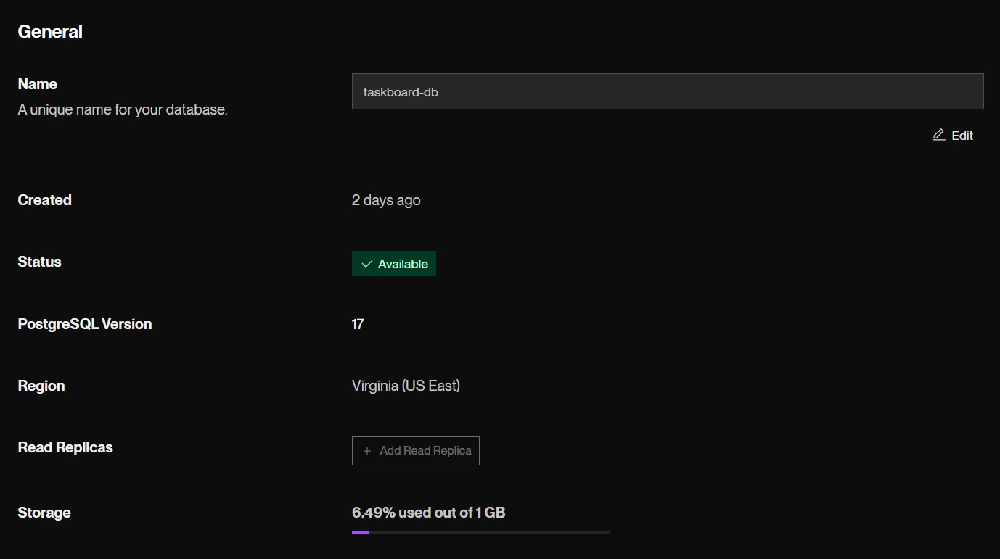
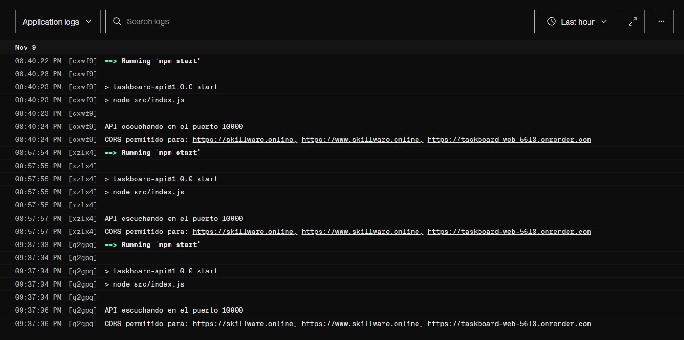
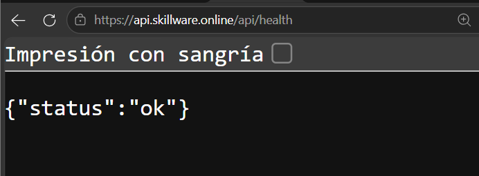
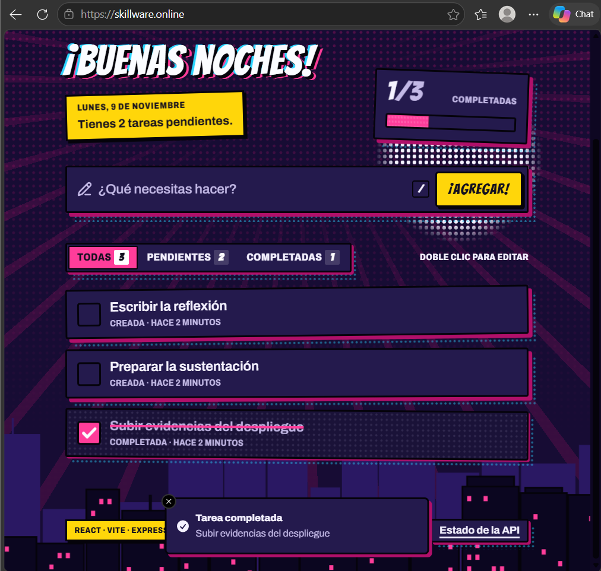
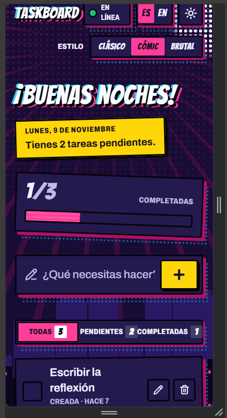
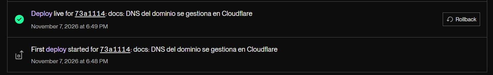
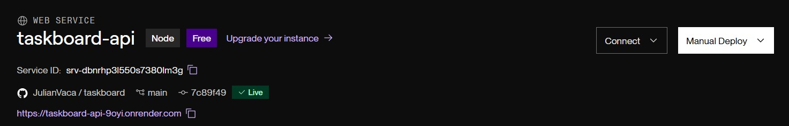
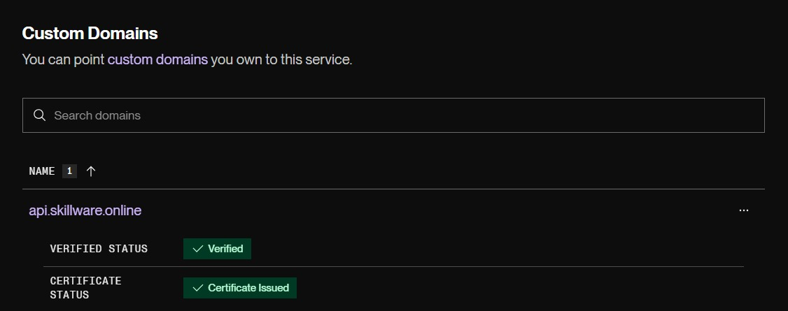
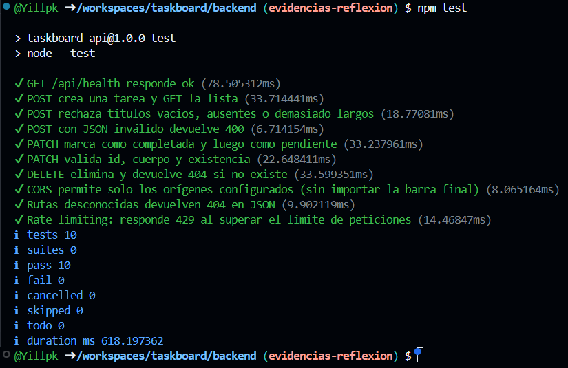

# Evidencias

| # | Captura | Archivo |
|---|---|---|
| 1 | Panel de Render con los tres servicios activos | `01-render-servicios.jpeg` |
| 2 | Base de datos `taskboard-db` disponible (PostgreSQL 17) | `02-render-postgres.jpeg` |
| 3 | Logs del Web Service mostrando `API escuchando en el puerto…` | `03-render-api-logs.jpeg` |
| 4 | `/api/health` respondiendo `{"status":"ok"}` en el dominio propio | `04-health.png` |
| 5 | Aplicación en uso: tareas creadas, una completada | `05-app-en-uso.png` |
| 6 | Aplicación en vista móvil | `06-app-responsiva.png` |
| 7 | Deploy automático disparado por un commit y servicio conectado al repositorio | `07-autodeploy-a.jpeg`, `07-autodeploy-b.jpeg` |
| 8 | Dominio `api.skillware.online` verificado con certificado SSL | `08-dominio.jpeg` |
| 9 | Pruebas del backend pasando, incluida la de rate limiting | `09-pruebas-rate-limit.png` |

## 1. Servicios en Render

## 2. Base de datos PostgreSQL

## 3. Logs de la API

## 4. Health check

## 5. Aplicación en uso

## 6. Vista móvil

## 7. Deploy automático

## 8. Dominio propio con SSL

## 9. Pruebas automáticas
